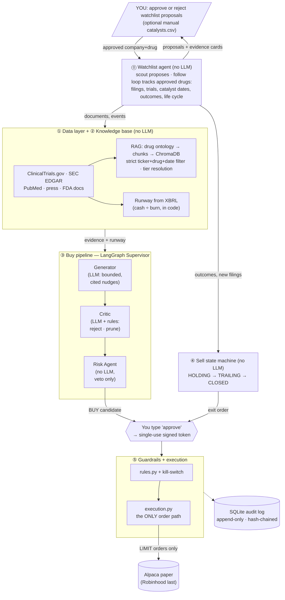
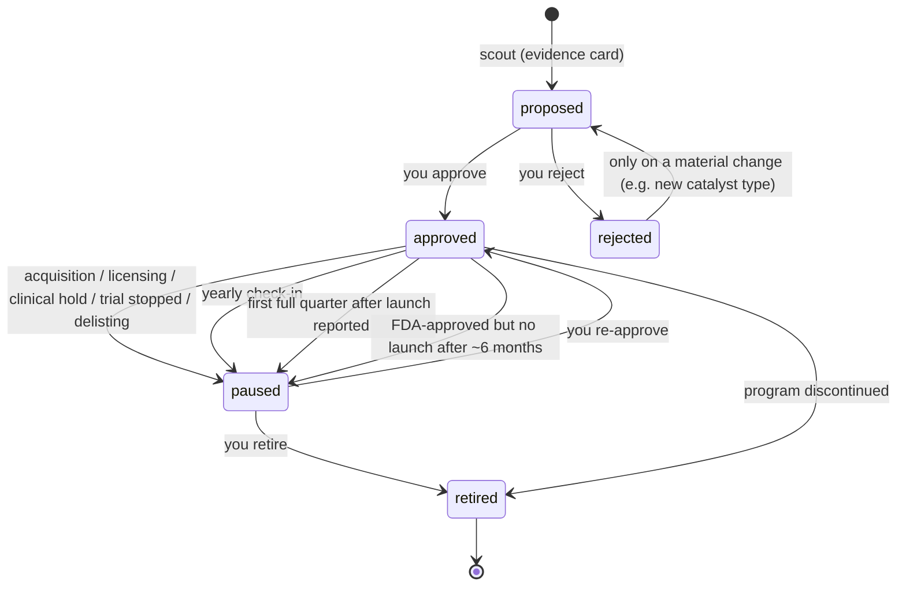
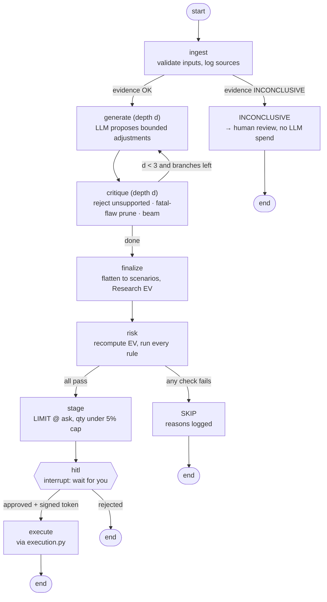
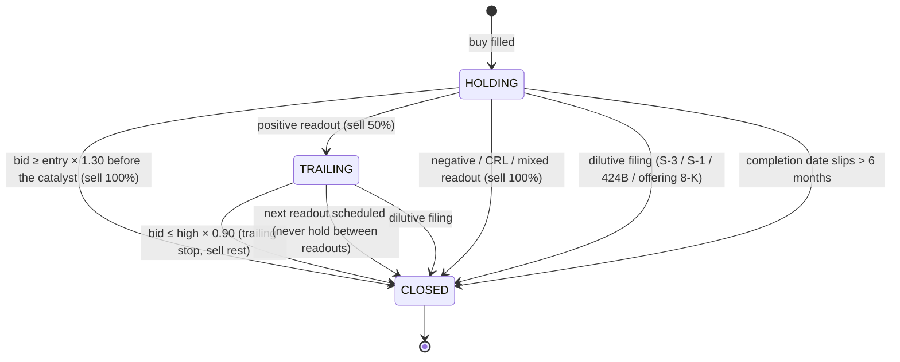

# BioTradeAI

Multi-agent decision support for trading biotech stocks around **catalysts**: FDA PDUFA
dates and Phase 3 readouts.
1. A **Research Agent** builds a Tree-of-Thoughts scenario analysis anchored to
   industry base rates.
2. An independent, fully deterministic **Risk Agent** re-checks it.
3. A **limit order** is staged for **your typed approval**.
4. Selling is an event-driven **state machine**, not an LLM.

> Decision support only — not financial advice. Default mode is `paper` (Alpaca paper
> trading). Live trading is blocked in code until the live gate exists.
>
> **Responsible data use:** BioTradeAI only reads from official public APIs (SEC,
> ClinicalTrials.gov, NCBI, openFDA) and your own broker account. It never scrapes
> websites, and it stays well under every provider's rate limit, enforced in code. See
> [Data sources and network guardrails](#data-sources-and-network-guardrails).

- **Set it up:** [docs/SETUP.md](docs/SETUP.md) (step by step, from install to the daily paper run)
- **Full design:** [IMPLEMENTATION_PLAN.md](IMPLEMENTATION_PLAN.md)
- **Every decision and deviation:** [docs/DECISIONS.md](docs/DECISIONS.md)

---

## Contents
- [Architecture at a glance](#architecture-at-a-glance)
- [The blocks, one by one](#the-blocks-one-by-one)
- [Watchlist life cycle](#watchlist-life-cycle)
- [Buy pipeline (Supervisor graph)](#buy-pipeline-supervisor-graph)
- [Tree of Thoughts in detail](#tree-of-thoughts-in-detail)
- [Sell state machine](#sell-state-machine)
- [Safety model](#safety-model)
- [Data sources and network guardrails](#data-sources-and-network-guardrails)
- [Repository layout](#repository-layout)
- [Commands](#commands)
- [Switching LLMs](#switching-llms)
- [Testing and evaluation](#testing-and-evaluation)
- [Project status](#project-status)

---

## Architecture at a glance



**How to read it:**
- Data flows top to bottom. Two things are left off to keep the picture readable:
  - Every block writes to the audit log; that is drawn only once.
  - The broker also sends quotes and positions back into the buy pipeline and the sell
    machine (read-only).
- LLMs appear in only two boxes, the Generator and the Critic. Neither box can reach a
  broker, change a threshold or do arithmetic.
- Every order, whether a buy or an exit, passes the same gates before `execution.py`
  sends it: your signed approval, the guardrail rules, and the kill-switch.

---

## The blocks, one by one

### 1 · Data layer — `src/biotradeai/data/` (no LLM)

| Block | File | What it does |
|---|---|---|
| ClinicalTrials.gov client | `clinicaltrials.py` | API v2 study lookup and search. Trial dates are treated as *claimed* (sponsor estimates), never as truth. |
| SEC EDGAR client | `edgar.py` | Submissions and XBRL company facts. Requires a descriptive User-Agent and is rate-limited to ≤ 10 requests/s. |
| Runway | `runway.py` | Cash (cash + marketable securities) ÷ quarterly burn, from XBRL. Handles year-to-date differencing, restatements (latest filing wins) and point-in-time `as_of`. Burn = max(latest quarter, mean of the last 4). |
| Freshness | `freshness.py` | TTL checks. Any input older than `ttl_hours` is rejected. |
| HTTP + network guardrails | `http.py`, `netpolicy.py`, `http_limiter.py` | Shared fetcher for every data source: host allowlist, a shared jittered rate limiter per source, daily budget, circuit breaker, retries that honour `Retry-After`, a mockable transport. See [Data sources and network guardrails](#data-sources-and-network-guardrails). |
| Pacing | `pacing.py` | Spreads bulk jobs across a time window and splits large lists into nightly rolling batches. |
| Catalysts / outcomes | `catalysts.py`, `outcomes.py` | Loaders for the **human-curated** CSVs. These, not CT.gov, are the source of truth for event dates and results. |
| Pollers | `pollers.py` | New SEC filings, each reported once, with offering 8-Ks classified in code. Changes to CT.gov primary completion dates. |

### 2 · Knowledge base (RAG) — `src/biotradeai/rag/`

| Block | File | What it does |
|---|---|---|
| Drug ontology | `ontology.py` | Maps pipeline code, generic, brand and old codes to one `Entity_ID`, so a renamed drug still matches its old risk factors. An LLM may *propose* names; only you approve them. |
| Ingest | `ingest.py`, `chunking.py` | Takes PDF/HTML/TXT and Item 1A risk factors. Splits into ~400-token chunks with 50 overlap, tagged with ticker, entity, tier, date and sha256. |
| Claim extraction | `claims.py` | Regex, no LLM: clinical hold active/lifted, primary endpoint met/not met, PDUFA date, CRL. Hedged risk-factor wording ("we *may* receive a CRL") is ignored. |
| Embeddings | `embeddings.py` | Switchable. Default `BAAI/bge-small-en-v1.5` (local); also Ollama embeddings, or a hashing embedder for tests. |
| Vector index | `index.py` | ChromaDB, local and persistent. Embeddings are supplied by our code. |
| Retriever | `retrieve.py`, `lexical.py` | **Strict pre-filter** on exact ticker AND entity AND `published_at ≤ as_of`. Then **hybrid ranking** (cosine + BM25, Reciprocal Rank Fusion). Then **tier resolution**: FDA/CT.gov > SEC > PubMed/press, and newest within a tier. An SEC claim at least as new as the FDA one that disagrees means **INCONCLUSIVE**. Confidence = source authority × chunk density. |

### 3 · Buy pipeline — `src/biotradeai/agents/`, `src/biotradeai/graph/buy_graph.py`

| Block | File | What it does |
|---|---|---|
| LLM switcher | `agents/llm.py` | One `LLMClient` interface for Anthropic, Ollama or a fake client. Every prompt is redacted before it leaves the process. |
| Base rates | `agents/base_rates.py`, `data/base_rates.yaml` | Probabilities and return assumptions that anchor every tree node, with cited sources. |
| ToT arithmetic | `agents/tot.py` | Bounded probability projection, residual collapse, tree EV. Pure code. |
| Research Agent | `agents/research.py` | **Generator** (LLM) proposes evidence-cited adjustments of at most ±0.15. **Critic** (separate prompt) can only reject them. It also applies fatal-flaw pruning and the beam. |
| Risk Agent | `agents/risk.py` | Fully deterministic, **veto only**. Recomputes EV independently and checks it against the Research EV. Checks runway, confidence, spread, concurrency, position room, freshness, and that the catalyst is still ahead. |
| Supervisor | `graph/buy_graph.py` | LangGraph state machine with a SQLite checkpointer. Every transition is re-validated by Pydantic. Routes to BUY candidate, SKIP or INCONCLUSIVE. Pauses for your approval. |

### 4 · Sell state machine — `src/biotradeai/graph/sell_graph.py`, `events.py`

A pure function `step(position, event) → (position, exits)`. There is no LLM anywhere.
Triggers are listed in the [Sell state machine](#sell-state-machine) section below.

### 5 · Guardrails and execution — `src/biotradeai/guardrails/`, `src/biotradeai/brokers/`

| Block | File | What it does |
|---|---|---|
| Rules | `guardrails/rules.py` | Pure functions that read `config/guardrails.yaml`: position cap (≤ 5% of equity), concurrency, EV ≥ 0.20, runway ≥ 6 months (prune below 3), spread ≤ 1.5%, confidence ≥ 0.70, TTL, drawdown, limit-only. |
| Kill-switch | `guardrails/killswitch.py` | Trips on daily drawdown > 3% or 3 consecutive API errors. It cancels open orders, blocks new ones and persists across restarts. Only a typed human `RESET` clears it. |
| Approval | `brokers/approval.py` | HMAC-SHA256 token over ticker, side, qty, limit price, expiry and nonce. Single use, valid for 15 minutes. |
| Execution | `brokers/execution.py` | **The only code that may call `place_order`** (an AST test enforces this). It runs: kill-switch → mode → order type → token → pre-trade checks → nonce → place. |
| Brokers | `brokers/alpaca_broker.py`, `fake_broker.py`, `robinhood_broker.py` | One `Broker` protocol. Alpaca is paper only and drops the account number. Robinhood is shadow-gated, deferred to the final phases. |

### 6 · Operations — `src/biotradeai/paper/`, `src/biotradeai/backtest/`, `store/`

| Block | File | What it does |
|---|---|---|
| Live gatherer | `paper/gather.py` | Collects RAG evidence, SEC runway, broker quote, equity and exposure (including open buy orders) into one validated `ResearchInputs`. |
| Paper runner | `paper/runner.py` | One cycle: exits first, then entries. Every order goes through approval and `execution.py`. A post-trade compliance check trips the kill-switch on any breach. |
| Review and gate | `paper/review.py` | Daily audit summary. Counts paper days and breaches toward the 90-day live gate. |
| Backtest | `backtest/` | Point-in-time harness with "leak" documents dated after the decision. Metrics: Brier, groundedness, independent breach check, escalation accuracy, latency. Writes reports to `reports/`. |
| Store | `store/sqlite_store.py` | Holds the audit log (append-only triggers and a SHA-256 hash chain), positions, approval nonces, kill-switch state, sell-machine state, seen filings, the request ledger, the SEC company cache, ingested-document fingerprints and catalyst events. |

### 0 · Watchlist agent — `src/biotradeai/watchlist/`, `data/signals.py`, `data/secindex.py`, `rag/sync.py` (no LLM)

| Block | File | What it does |
|---|---|---|
| SEC index + company cache | `data/secindex.py` | One SEC daily index file per business day lists every filing. Company records (industry code, tickers, exchange) are cached for 30 days. |
| Text signals | `data/signals.py` | Deterministic extraction from filings: catalyst sentences with exact dates or windows, drug codes, endpoint met/missed, CRL, FDA approval, launch, discontinuation, acquisition and licensing. Hedged wording is ignored. |
| Scout | `watchlist/scout.py` | Proposes company+drug pairs using two signals: 8-Ks from listed biotechs, and ClinicalTrials.gov Phase 3 trials finishing in 3–12 months (sponsor matched to a ticker). Filters out: profitable companies, under 6 months of runway, no runway data, drugs already FDA-approved (openFDA), and, with quotes, market cap over $5B. Then it ranks, caps, and writes an evidence card. Never approves anything. |
| Watchlist | `watchlist/model.py` | One entry per company+drug, stored in `data/watchlist.yaml`. Status goes proposed → approved / rejected → paused / retired. Duplicates and past rejections are suppressed. |
| Catalyst events | `watchlist/catalysts.py` | Agent-managed events. The date is a field, earlier dates are kept, and the newest filing wins. A same-day disagreement marks the event *conflicting*, which isn't traded. Only events with an exact date or a window of a quarter or less are tradable. |
| Document sync | `rag/sync.py` | Loads 10-K/10-Q risk factors, 8-Ks with exhibits, trial records including posted results, and PubMed abstracts, each with its real publication date and each only once. |
| Follow loop | `watchlist/follow.py` | Daily, for approved drugs: new filings, trial status, outcomes, approval and launch, and the pause rules. |

---

## Watchlist life cycle



**What one approval covers:** the drug through every phase (development → FDA
approval → launch) until the first full quarter after launch is reported. Each
catalyst inside that span is still evaluated fresh, and every order still needs your
typed approval. Paused drugs get no new buys, but the sell rules keep watching any
open position.

**Where events come from:** catalyst dates are taken only from company filings, with
the exact sentence and link kept. ClinicalTrials.gov completion dates are sponsor
estimates and are shown on cards but never used as catalyst dates.

---

## Buy pipeline (Supervisor graph)



**How the graph behaves:**
- Each box is a LangGraph node.
- Nodes pass only validated JSON contracts (`CatalystState`, `ResearchInputs`,
  `ToTNode`), so workers never call each other.
- State is checkpointed, so a run waiting for your approval survives a restart.

## Tree of Thoughts in detail

| Depth | Question | Outcomes | Probability source |
|---|---|---|---|
| 1 | Clinical outcome | success / partial / failure (always all three) | BIO 2021 phase-transition rates |
| 2 | Regulatory reaction | e.g. clean path / FDA asks for more data | `base_rates.yaml`, conditional on depth 1 |
| 3 | Financing / dilution | no raise / dilutive raise | bucket chosen by runway, computed in code |

**Rules the tree follows:**
- **The LLM may only nudge probabilities,** by at most ±`max_prob_adjustment` per
  outcome, and only by citing evidence IDs. Code rebalances siblings to sum to exactly 1.
- **Returns come only from `base_rates.yaml`.** A leaf's return = product of
  (1 + step return) along its path, minus 1. The LLM prompt contains no return figures.
- **The Critic can only make the tree more conservative.** It may reject an adjustment,
  which restores the base rate. An adjustment with no evidence, a missing verdict or an
  unusable reply all count as rejected.
- **Fatal flaws prune.** An active clinical hold, or runway under 3 months, cuts the
  success and partial branches. The beam keeps the 2 most likely clinical outcomes.
- **Pruned branches still count.** They are collapsed into one residual scenario at
  `residual_scenario_return` (−70%), so **EV always covers 100% of outcomes**.
- **EV is computed twice, in two different ways.** The Research Agent walks the tree;
  the Risk Agent sums the flat scenario list. If they disagree by more than 0.0001,
  the trade is blocked and logged.

## Sell state machine



**Every exit:**
- is a **SELL LIMIT at the current bid** (it fills at once but is never a market order);
- is checked by the order-type guardrail;
- is audit-logged;
- needs your approval, exactly like a buy.

Thresholds come from `config/guardrails.yaml` (`sell.*`).

---

## Safety model

1. **The LLM never enforces rules or does arithmetic.** Every threshold is in
   `config/guardrails.yaml`. The loader rejects unknown, missing or out-of-range keys,
   and the position cap has a hard ceiling of 5%.
2. **There is one order path.** Only `brokers/execution.py` may place orders. Agents
   and graphs cannot import brokers, and tests enforce this.
3. **Limit orders only.** Market, stop and stop-limit orders are rejected by both the
   rules and the broker adapter.
4. **A human approves every order.** Approval is a single-use HMAC token with a
   15-minute life. Shadow and live modes cannot place orders through this path.
5. **Everything is audited.** Every transition, thought trace, source hash and order is
   logged. The audit log is append-only (SQLite triggers) and hash-chained, so tampering
   is detectable.
6. **Secrets and account numbers are redacted** before anything is logged or sent to an
   LLM.
7. **Paper first.** Live trading needs `mode: live`, `BIOTRADEAI_LIVE=1`, a typed
   confirmation, 90 paper days with zero breaches, and the pilot size caps (1%, one
   position).
8. **Good network citizen.** Only allowed hosts, polite rate limits, daily budgets and
   a circuit breaker. See the next section.

---

## Data sources and network guardrails

BioTradeAI collects data only in ways the providers allow, and never in bursts.
The rules live in [`src/biotradeai/data/netpolicy.py`](src/biotradeai/data/netpolicy.py)
and are enforced for every request by the shared fetcher in
[`data/http.py`](src/biotradeai/data/http.py). Tests in
[`tests/unit/test_netpolicy.py`](tests/unit/test_netpolicy.py) prove each rule.

### What we use, and what we don't
| Used (official, public or your own account) | Never used |
|---|---|
| SEC EDGAR APIs and filing archives | scraping company or investor-relations websites |
| ClinicalTrials.gov API v2 | press-release wires, news sites, search engines |
| NCBI E-utilities (PubMed abstracts) | paid catalyst calendars, or any site whose terms forbid automated access |
| openFDA (Drugs@FDA approvals, used by the scout) | anything behind a login or paywall, CAPTCHA bypassing, proxies or IP rotation |
| Alpaca, with your own paper keys | SEC full-text search (not documented for automated use) |

### Per-source limits (about half of what each provider allows)
| Source | Provider's published rule | BioTradeAI setting | Daily budget |
|---|---|---|---|
| SEC EDGAR | ≤ 10 requests/s per user, declared User-Agent | 5 requests/s | 20,000 |
| ClinicalTrials.gov | no official figure found; ~50/min is the most conservative cited | 0.8 requests/s (≈ 48/min) | 5,000 |
| NCBI / PubMed | ≤ 3/s without a key, ≤ 10/s with a free key | 2/s, or 5/s with a key | 5,000 |
| openFDA | 240/min and 1,000/day without a key; 120,000/day with a free key | 1/s | 500, or 50,000 with a key |
| Alpaca | per-account API limits | 1/s, reads plus your approved orders | none, so exits are never blocked |

### How every request is protected
1. **Host allowlist:** a domain that isn't listed is refused before any connection is
   made, including redirects to other domains. A test scans the whole codebase for
   URLs and fails on any unlisted host.
2. **One shared limiter per source, with jitter:** every client of a source waits on
   the same limiter, and gaps are randomly lengthened (never shortened), so requests
   never fall into a fixed rhythm.
3. **Back off when asked:** HTTP 429/5xx responses and network errors are retried with
   exponential back-off. The server's `Retry-After` header is honoured, capped at
   5 minutes. Other 4xx responses are never retried.
4. **Daily budget:** a hard cap per source per UTC day, stored in SQLite so it holds
   across scheduled runs. When it's reached, the source pauses until tomorrow.
5. **Circuit breaker:** after 3 failed requests in a row, a source is switched off for
   the rest of the UTC day. This is logged to the audit trail, and the run carries on
   without that source.
6. **Identify ourselves:** the SEC User-Agent you set, plus `tool=BioTradeAI` and your
   optional `NCBI_EMAIL` for NCBI. Your email is sent only if you configure it.

### Balanced bulk jobs
Off-peak alone just moves a burst to the night, so bulk jobs (the upcoming watchlist
scout, the biotech-universe refresh, document sync) are also **spread out**:
- **Pacing:** `data/pacing.py:paced()` spreads a job evenly across a time window, with
  random gaps. For example, 800 requests over 2 hours is about one every 9–11 seconds.
  The per-source limiter still applies on top.
- **Rolling batches:** `rolling_batch()` handles a stable 1-in-N slice per night. For
  example, refreshing 800 companies with `parts=7` touches about 115 a night and
  every company once a week.
- **Incremental only:** the SEC daily filing index replaces polling every company, and
  filings and documents already seen are never fetched again.

**Expected load with 30 followed drugs:** a few hundred requests a day across all
sources, spread over hours. The one-time universe build is about 800 SEC requests,
spread over a week of nights.

**Data use:** SEC, ClinicalTrials.gov, FDA and NLM data are public US-government data.
PubMed abstracts can be copyrighted by their publishers; they are stored only in your
local knowledge base for your own research and are never committed or redistributed.
The repository's test data is synthetic.

---

## Repository layout

```
BioTradeAI/
  config/guardrails.yaml        every risk threshold (single source of truth)
  data/
    watchlist.yaml              agent proposals + YOUR approvals (git-ignored)
    catalysts.csv               optional manual catalysts
    outcomes.csv                YOU: readout results
    synonyms.yaml               YOU: drug names -> Entity IDs
    base_rates.yaml             base rates + return assumptions (review them)
    fixtures/                   offline test data (CT.gov, EDGAR, RAG, scenarios, sell, backtest)
  docs/
    SETUP.md                    step-by-step setup
    DECISIONS.md                design decisions and deviations
  scripts/                      fixture generators
  src/biotradeai/
    config.py  schemas.py  events.py  redact.py  paths.py  inputs.py
    data/  rag/  agents/  graph/  guardrails/  brokers/  paper/  backtest/  store/
    cli.py  cli_trading.py  cli_rag.py  cli_agents.py  cli_paper.py
  tests/unit/  tests/integration/  tests/eval/
```

## Commands

**Setup and checks**
```powershell
python -m biotradeai config-check          # validate config/guardrails.yaml
python -m biotradeai init-db               # create data/biotradeai.db
python -m biotradeai audit-tail -n 20      # show audit log + verify hash chain
python -m biotradeai llm-ping --llm ollama:llama3.2:3b
```

**Data**
```powershell
python -m biotradeai runway MRNA           # live SEC runway (needs SEC_USER_AGENT)
python -m biotradeai trial NCT04368728     # live ClinicalTrials.gov
python -m biotradeai catalysts             # list data/catalysts.csv
```

**Knowledge base**
```powershell
python -m biotradeai rag ingest doc.pdf --ticker ABCD --tier 1 --date 2026-01-05 --url https://... --drug ABC-123
python -m biotradeai rag query ABCD ABC-123 "hepatic safety signals?"
python -m biotradeai rag eval              # recall/bleed on the 30-drug test set
python -m biotradeai ontology resolve abcinib   # list | proposals | propose | approve --index N
```

**Agents and evaluation (offline fixtures)**
```powershell
python -m biotradeai evaluate --fixture data\fixtures\scenarios\onco.yaml
python -m biotradeai sell-replay
python -m biotradeai backtest              # base-rate baseline -> reports/
python -m biotradeai backtest --llm ollama:llama3.2:3b
```

**Watchlist (scout, approval, follow)**
```powershell
python -m biotradeai watchlist scout                 # weekly: propose company+drug pairs
python -m biotradeai watchlist list                  # --status proposed|approved|paused|...
python -m biotradeai watchlist show ABCD:ABC-123     # the approval card
python -m biotradeai watchlist approve ABCD:ABC-123  # reject | retire --reason "..."
python -m biotradeai watchlist follow                # daily: filings, trials, events, life cycle
python -m biotradeai watchlist events                # agent-managed catalyst dates
python -m biotradeai watchlist resync ABCD:ABC-123   # re-run first sync (no duplicates)
```

**Trading (Alpaca paper)**
```powershell
python -m biotradeai account               # needs Alpaca paper keys
python -m biotradeai positions
python -m biotradeai paper run             # one cycle: exits then entries, approval prompts
python -m biotradeai paper run --broker fake --auto-reject   # dry run
python -m biotradeai paper review          # today's audit summary
python -m biotradeai paper gate            # paper days / breaches toward the live gate
python -m biotradeai killswitch status     # trip | reset
```

## Switching LLMs

Every agent role picks its model with a spec string `<provider>:<model>`:

| Spec | Meaning |
|---|---|
| `ollama:llama3.2:3b` | local model via Ollama (`OLLAMA_HOST`, default `http://localhost:11434`) |
| `anthropic:claude-sonnet-5-5` | Claude via API (`pip install -e ".[anthropic]"`, set `ANTHROPIC_API_KEY`) |
| `fake` | deterministic stub used by tests |

Resolution order: CLI `--llm` → `BIOTRADEAI_LLM_<ROLE>` (`RESEARCH`, `CRITIC`) →
`BIOTRADEAI_LLM` → default `anthropic:claude-sonnet-5-5`. Embeddings switch the same way
with `BIOTRADEAI_EMBEDDER` (`st:<model>`, `ollama:<model>` or `hash`).

## Testing and evaluation

Quality gates, run before every commit:

```powershell
ruff check .
```

```powershell
mypy
```

```powershell
pytest
```

- `pytest` runs about 400 offline unit tests. They never call a real broker
  `place_order`.
- `pytest -m integration` runs the live, read-only probes: SEC, CT.gov, Alpaca paper
  account and Ollama.

| Check | Result on the included fixtures |
|---|---|
| RAG recall@5 (30 drugs, 61 queries) | 1.000, zero cross-ticker bleed |
| Phase 5 acceptance (ONCO end-to-end, conflict → INCONCLUSIVE, dilution trap → SKIP, EV mismatch blocks) | pass |
| Sell replays (8 event streams, every trigger and boundary) | 8 / 8 exact |
| Backtest (12 synthetic cases): leaks / breaches / groundedness / escalation | 0 / 0 / 100% / 100% |
| Backtest Brier (target ≤ 0.18) | 0.227, base rates only; a stronger model must beat this |

The backtest cases are synthetic. They prove the harness and the safety properties, not
real predictive skill.

## Project status

| Phase | What | Status |
|---|---|---|
| 0 | Bootstrap: config, schemas, SQLite audit store, LLM switcher | done |
| 1 | Data layer: CT.gov, EDGAR, runway, catalysts.csv | done |
| 2 | Guardrail rules, approval tokens, brokers, kill-switch, execution | done |
| 4 | RAG: ontology, ingest, hybrid retrieval, tier/conflict resolution | done |
| 5 | Research ToT + Risk Agent + LangGraph supervisor | done |
| 6 | Sell state machine, EDGAR/CT.gov pollers | done |
| 7 | Point-in-time backtest, metrics, reports | done |
| 8 | Alpaca paper trading: runner, daily review, live-gate counter | built; the 8–12 week run needs your keys |
| — | Network guardrails: allowlist, polite rates, budgets, breaker, pacing | done |
| — | Watchlist scout, approval cards, automatic document sync and follow loop | done |
| 3 | Robinhood spike (read-only, no orders) — see docs/robinhood_spike.md | done (2 questions moved to Phase 9) |
| 9, 10 | Robinhood shadow mode, live pilot | next (needs your go-ahead) |

## License

[MIT](LICENSE) © 2026 sathishkdev. Provided "as is", without warranty: decision support only, not financial advice.
